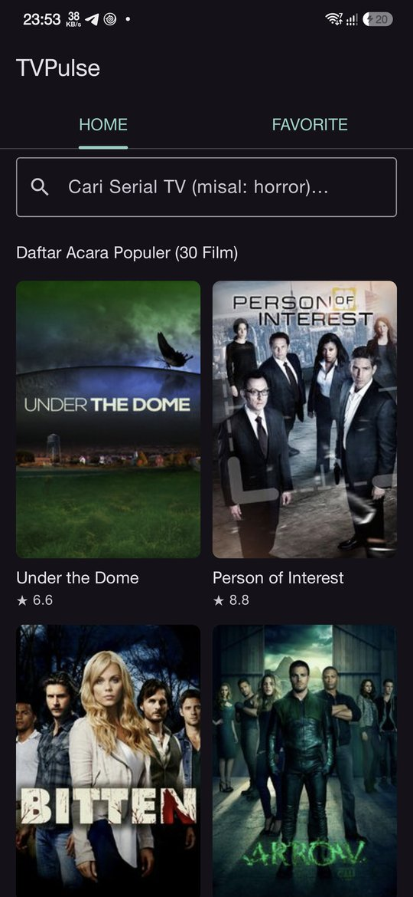
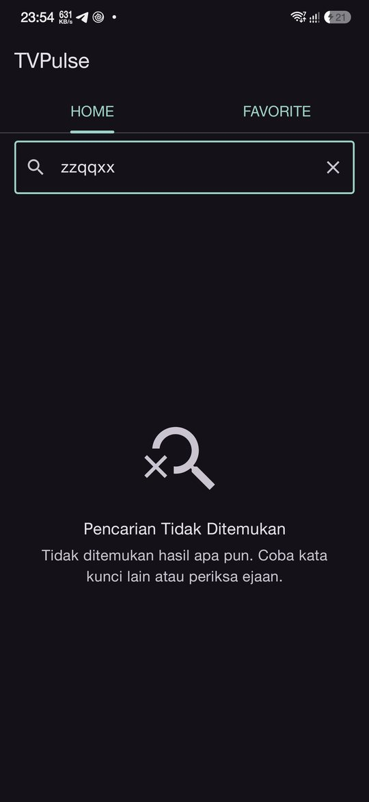
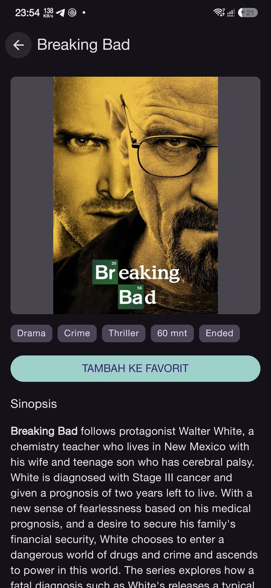
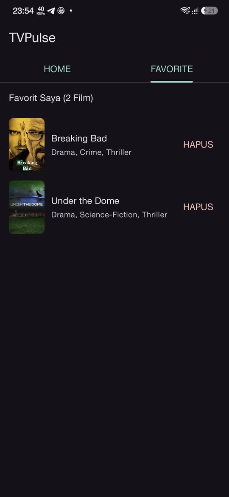
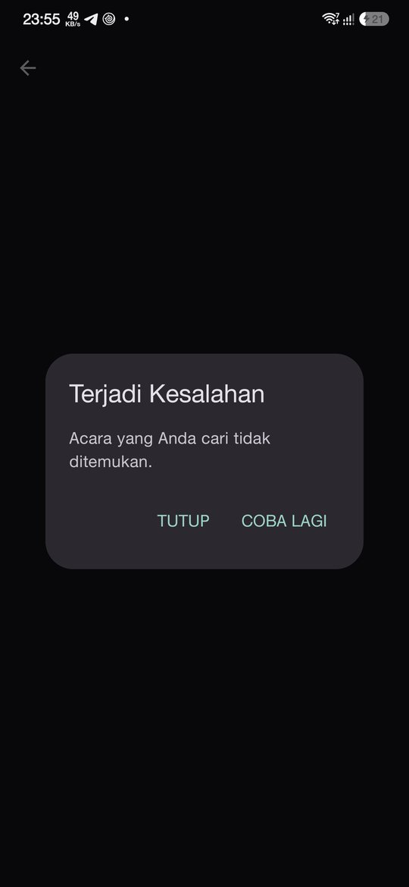

# TVPulse

TV show catalog Android app built for the BookCabin Android Developer technical test, using the public [TVmaze API](https://www.tvmaze.com/api).


## Screenshots

| Home | Search (empty) | Detail | Favorites | Error |
|------|----------------|--------|-----------|-------|
|  |  |  |  |  |

## Getting started

No API key needed — TVmaze is public.

```bash
./gradlew assembleDebug
./gradlew testDebugUnitTest
```

Requires JDK 17+ to run Gradle (`gradle/gradle-daemon-jvm.properties` pins the daemon to JDK 25; Android Studio's bundled JDK works).

## Requirements coverage

| Step | Requirement | Where |
|------|-------------|-------|
| 1 | MVVM + Clean Architecture, DI, local storage | `ui → domain ← data`, Hilt, Room |
| 2 | Top 30 from `/shows`, transformed in the Repository | `ShowRepositoryImpl.getTopShows()` (`take(30)`) |
| 2 | Search `/search/shows?q=` with debounce on StateFlow | `HomeViewModel` (`debounce(400.milliseconds)`) |
| 2 | Detail `/shows/{id}` from the selected id | `DetailViewModel` (id from the navigation arguments) |
| 3 | Favorites update in real time | Room `Flow` → `FavoriteViewModel` / `DetailViewModel` |
| 4 | Sealed `Loading / Success / Error / Empty`, shimmer, empty states, image caching | `UiState`, `ShimmerBox`, `EmptyState`, Coil 3 |
| 5 | Error dialog on no connection / API failure | `ErrorDialog` via `UiStateContent` |
| 6 | `movieapp://detail/{id}` on cold and warm start | `AndroidManifest.xml` + `TvPulseNavHost` |

## Architecture

MVVM with Clean Architecture layering, single Gradle module.

```
┌─────────────────────────────────────────────────┐
│  ui/            Compose screens + ViewModels    │
│                 observes StateFlow<UiState<T>>  │
└────────────────────┬────────────────────────────┘
                     │ depends on
┌────────────────────▼────────────────────────────┐
│  domain/        Show + repository interfaces    │
│                 pure Kotlin, no Android imports │
└────────────────────▲────────────────────────────┘
                     │ implements
┌────────────────────┴────────────────────────────┐
│  data/          Repository implementations      │
│                 ├── remote/  Retrofit + DTOs    │
│                 ├── local/   Room               │
│                 └── mapper/  DTO/entity → domain│
└─────────────────────────────────────────────────┘

  core/           common, network, database, designsystem
  di/             Hilt modules
  navigation/     type-safe routes + NavHost + deeplink
```

### Package structure

```
com.example.tvpulse/
├── core/
│   ├── common/          AppError, DataResult, UiState
│   ├── network/         safeApiCall, NetworkErrorMapper
│   ├── database/        Room database
│   └── designsystem/    theme + ShimmerBox, EmptyState, ShowPoster, ShowCard, ErrorDialog, UiStateContent
├── data/
│   ├── remote/          TvMazeApi, DTOs
│   ├── local/           FavoriteShowDao, FavoriteShowEntity
│   ├── mapper/          ShowMapper, FavoriteMapper
│   └── repository/      ShowRepositoryImpl, FavoriteRepositoryImpl
├── domain/
│   ├── model/           Show
│   └── repository/      ShowRepository, FavoriteRepository
├── di/                  NetworkModule, DatabaseModule, RepositoryModule
├── navigation/          MainRouteKey, DetailRouteKey, TvPulseNavHost
└── ui/
    ├── main/            HOME / FAVORITE tabs
    ├── home/
    ├── detail/
    └── favorite/
```

**Why a single module:** the packages already follow module boundaries, so splitting into `:core:network`, `:feature:home` and so on is a folder move away. For a test of this size, a module graph and convention plugins would cost more than they give.

**On use cases:** no use-case layer. A `GetTopShowsUseCase { repository.getTopShows() }` would be a pass-through with no logic, and one per endpoint is boilerplate rather than structure. The Clean Architecture boundary is still enforced: `domain/` is plain Kotlin, and every repository is an interface that tests replace with a fake.

## Key design decisions

### One `UiState<T>` for every screen
`Loading / Success / Error / Empty` is defined once and shared by Home, Detail and Favorites. `DataResult.toUiState()` turns an empty list into `Empty`, so screens never check `isEmpty()` themselves.

### Error dialog, then pull-to-refresh
Errors open a dialog (**Tutup** / **Coba Lagi**). After closing it, the screen keeps a "Tarik ke bawah untuk memuat ulang" hint instead of going blank, and pull-to-refresh retries. Every new failure re-opens the dialog. The shimmer is the only loading indicator, so the pull indicator never spins.

There is no `ConnectivityManager` pre-check: "connected" can still mean a captive portal or a dead VPN, so the real request is the only reliable signal. OkHttp fails fast when offline.

### Debounced search
The query is a `StateFlow` debounced by 400 ms in `HomeViewModel`. A new query or refresh cancels the in-flight request, so a slow old response can never overwrite a newer one. A blank query shows the top 30.

### Room as the single source of truth for favorites
Favorites are read only through Room `Flow`s. Toggling on Detail writes to Room and touches no UI state; the Favorites tab updates because it observes the same table. Each favorite stores a full snapshot of the show, so the tab works offline.

### Deeplink: cold and warm start
`movieapp://detail/{id}` is declared on `DetailRouteKey` with `navDeepLink<DetailRouteKey>(basePath = "movieapp://detail")`, so taps and links share the same type-safe route.

- **Cold start:** the NavHost reads the launch intent and builds a Main → Detail back stack, so Back returns to Home.
- **Warm start:** `MainActivity` is `singleTop`, so the link is delivered to the running Activity through `onNewIntent`, which forwards it to `navController.handleDeepLink()`.

`DetailViewModel` reads the id with `savedStateHandle["id"]` rather than `toRoute<DetailRouteKey>()`: `toRoute()` builds an Android `Bundle`, which is a stub in JVM unit tests. The key is the route's property name, and `DetailViewModelTest` breaks if they ever drift apart.

### Caching
- **Images:** Coil 3 memory + disk cache, downsampled to the view size.
- **HTTP:** deliberately **no** OkHttp cache. TVmaze sends `Cache-Control: max-age=86400` on `/shows`; honoring it would serve Home from disk while offline and hide the required error dialog. If offline browsing is needed later, the next step is a Room-backed offline-first list with stale-while-revalidate.

### HTML summaries
TVmaze summaries contain HTML (`<p><b>…</b></p>`). They are rendered with Compose's `AnnotatedString.fromHtml()`, which keeps bold/italic and decodes entities, instead of stripping tags with a regex.

### Localization-ready
All UI copy lives in `res/values/strings.xml` (Bahasa Indonesia, matching the mockup), and errors map to string resources in the UI layer. Adding English or Thai is a new `values-en/` or `values-th/` folder with no code changes. Dynamic content (in a booking app: cities, fare rules) would be localized server-side via `Accept-Language`.

### Base URL in Gradle
`TVMAZE_BASE_URL` is a `BuildConfig` field, so a staging host is a one-line `buildTypes` override when one exists.

## Testing

Unit tests run on the JVM (`./gradlew testDebugUnitTest`, 25 tests):

| Test | Covers |
|------|--------|
| `ShowRepositoryImplTest` | 240 → 30 transformation, search unwrapping, error mapping (offline, timeout, 404, 5xx) |
| `HomeViewModelTest` | debounce (fast typing → one request), top 30 vs search, Empty, Error, refresh, clearing the query |
| `DetailViewModelTest` | loads by route id, favorite toggle flows back in real time, no-op before load, error + retry |
| `ShowMapperTest`, `FavoriteMapperTest`, `UiStateTest` | null-safe mapping, entity round trip (incl. empty genres), state mapping |

`HomeViewModelTest` drives the 400 ms debounce with virtual time (`advanceTimeBy`), so it runs in milliseconds.

### Manual: deeplink

```bash
# Cold start
adb shell am force-stop com.example.tvpulse
adb shell am start -W -a android.intent.action.VIEW -d "movieapp://detail/169"

# Warm start: open the app, press Home, then
adb shell am start -W -a android.intent.action.VIEW -d "movieapp://detail/1"

# Edge cases
adb shell am start -W -a android.intent.action.VIEW -d "movieapp://detail/999999999"   # not found → error dialog
adb shell am start -W -a android.intent.action.VIEW -d "movieapp://detail/abc"         # non-numeric → opens Home
```

Cold and warm start both open Detail, and Back returns to Home. On warm start `am start` reports `LaunchState: HOT` (the running Activity is reused).

### Manual: error handling
Airplane mode → pull to refresh → error dialog → Tutup → pull again → dialog again → airplane mode off → pull → data.

## Libraries

| Need | Choice | Why |
|------|--------|-----|
| UI | Jetpack Compose + Material 3 | Declarative state → UI, shared `UiStateContent` |
| DI | Hilt | Compile-time graph validation |
| HTTP | Retrofit + OkHttp | Standard; one place for timeouts and logging |
| JSON | kotlinx.serialization | No reflection; default values handle TVmaze's nullable fields |
| Images | Coil 3 | Compose-native, memory + disk cache, downsampling |
| Persistence | Room | `Flow` queries make favorites reactive |
| Navigation | Navigation Compose (type-safe) | One route class for taps and deeplinks |
